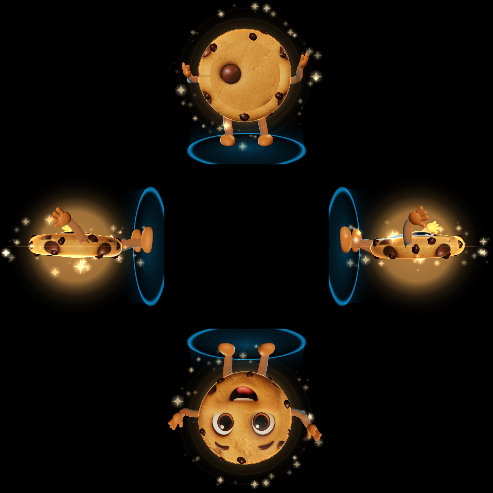

# Crumby Hologram · Jarvis & Crumby

A desk "hologram" assistant for a **Pepper's ghost** display: a phone, tablet or monitor lies
flat and face-up, and a clear acrylic sheet (or a 4-sided pyramid) above it reflects the glowing
character so it seems to float. Black pixels show up as see-through, so everything is drawn on
pure black.

**Live:** https://tyleraus96-ux.github.io/crumby-hologram/

| Idle | Listening | Thinking | Talking | Wave | Pyramid |
|---|---|---|---|---|---|
|  |  |  |  |  |  |

Crumby is a set of pre-rendered animated loops (`assets/video/crumby-sprite.mp4`); the Jarvis orb is real-time 3D
(three.js r186, vendored in `vendor/`, no CDN).

## Characters
- **Crumby (default):** the real Island Crumbs mascot, a puffy round chocolate chip cookie with
  big brown eyes, a wide open smile, dough noodle arms with mitten hands and rounded feet. He is
  played from seven short video loops rendered on pure black, packed back to back in one
  720×720 H.264 file (main profile, a keyframe every 0.5 s, about 3.9 MB):
  `idle`, `wave`, `listen` (leans in, hand to ear), `think` (looks up, hand on chin) and three
  talking variants (`talk1-3`). Every clip starts and ends on the same pose with the same camera
  and scale, so the app cuts or crossfades between them seamlessly: he waves when the app opens and
  on each new conversation, listens while you speak, thinks while Grok answers, cycles the talking
  loops while the voice plays, then settles back to idle. The source keyframe and raw clips are in
  `video-src/`. The app downloads the file once (progress bar on the start screen) and plays it
  with just two video elements: one shows the current loop while the other waits, paused on the
  first frame of the next one, so loop points and switches don't stall.
- **Jarvis orb 3D:** a glowing core in a plasma shell, tilted gyroscope rings with dashed HUD
  arcs, a voice waveform ring and a particle cloud.

## States
| State | Look |
|---|---|
| Idle | Crumby stands and sways; the orb breathes |
| Listening | Crumby cups his ear and leans in; the orb's cyan ripples follow your mic level |
| Thinking | Crumby looks up, hand on chin; the orb turns gold and spins up |
| Talking | Crumby chats and gestures (talking loops, not lip-synced); the orb follows the voice's real amplitude |

## Display modes (gear icon, bottom right, or press `s`)
- **Single sheet:** one big image, for a flat sheet of acrylic tilted at 45°. A reflection is
  flipped, so use **Mirror ↔** (and **Flip ↕** if it appears upside down) until it reads right.
- **Pyramid (4 sides):** four views around the centre, tops pointing outward, for the classic
  upside-down pyramid placed point-down on the middle of the screen. Crumby shows his front on all
  four sides; for the orb, **4 camera angles** renders front, sides and back, or **Front on all
  sides**. Use **Size** and **Pyramid gap**
  to match your pyramid. **Guides** draws faint alignment lines.
- **Brightness** boosts the glow (reflections lose a lot of light).

## Talking
Tap anywhere (or press **Space** on a Mac) to talk; it stops by itself when you pause, or tap
again. Tapping while it speaks interrupts it.

- **Demo mode (no key):** listens, then answers with scripted lines in the real xAI voices
  (Crumby: Ursa, higher pitch; Jarvis: Helios), pre-generated as small MP3s in `assets/voice/`.
- **Live mode:** open settings and paste your xAI API key. It's stored **only in that browser's
  localStorage** and is sent only to `api.x.ai`. Then:
  speech → `grok-voice-transcribe-2.0` (`/v1/stt`) → `grok-4.20-0309-non-reasoning` (streamed
  `/v1/chat/completions`) → `/v1/tts`, spoken sentence by sentence as it streams.
  Crumby uses the **Ursa** voice, Jarvis the deep **Helios** voice (change either in settings;
  the list comes from `/v1/tts/voices`). Speech recognition can be switched to the browser's
  Web Speech engine.

## iPhone setup
1. Open the live link in **Safari**, tap **Share › Add to Home Screen**, and launch it from the
   home screen icon (full screen, no browser bars). Tap **Tap to start Crumby**: that tap is what
   iOS needs before it allows sound.
2. Brightness to max, turn on **Do Not Disturb** / a Focus, turn off Auto-Lock if the screen
   still dims (the app also asks the screen to stay awake).
3. Allow the microphone when asked. Turn the volume up. Speech plays through an audio element,
   which normally works even in silent mode, but if you hear nothing, switch silent mode off
   (a note appears on screen if iOS blocks the sound).
4. Lay the phone flat, face up, under the acrylic (45° sheet) or pyramid, in a dim room.

## Mac Mini setup
Plug in a monitor (or small HDMI screen) lying flat and facing up, open the live link in Safari or
Chrome, press **f** (or the Full screen button) and set the acrylic above it. Keys: `Space` talk,
`c` switch character, `p` pyramid, `m` mirror, `s` settings.

### Optional local proxy (keeps the key off the browser)
xAI's API allows browser calls (CORS), so the proxy isn't required. On the Mac Mini you can still
keep the key in the environment instead of the browser:

```sh
git clone https://github.com/tyleraus96-ux/crumby-hologram && cd crumby-hologram
XAI_API_KEY=your-key-here node proxy/server.mjs     # Node 18+, no installs
open http://localhost:8787
```
The page detects the proxy and switches to live mode without asking for a key. It listens on
`127.0.0.1` only; set `HOST=0.0.0.0` to reach it from your phone on a trusted home network
(note: browsers only allow the mic on `https` or `localhost`, so the phone should use the
GitHub Pages link).

## URL options
`?char=crumby|orb&mode=single|pyramid&views=angles|front&mirror=1&state=talking&showcase=1&clean=1` for presets
(`state=idle|listening|thinking|talking|wave` previews a state; `t=2.2` freezes time for stills; `showcase=1` loops all states silently).
`node tools/previews.mjs` re-renders the preview images (needs `playwright-core` and Chrome).

## Limits
- iOS asks for the microphone again after the app is relaunched from the home screen.
- iOS silent mode can mute audio; Low Power Mode may cap the frame rate at 30 fps.
- No wake word yet: it's tap (or Space) to talk.
- Jarvis has no access to calendars, email or smart-home devices yet.
- Crumby's mouth moves with the talking loops, not with the exact words.
- On iPhone the clips are muted, inline and preloaded; in Low Power Mode iOS may hold them until
  the first tap. Local servers must support HTTP byte ranges for Safari video (`proxy/server.mjs`
  does; `python -m http.server` does not).
- Needs WebGL. If a phone gets hot or drops frames, the app lowers its resolution automatically
  (pixel ratio is capped at 2).

Crumby and Island Crumbs art © Island Crumbs. Code: MIT. three.js © three.js authors (MIT, `vendor/three.LICENSE`).
